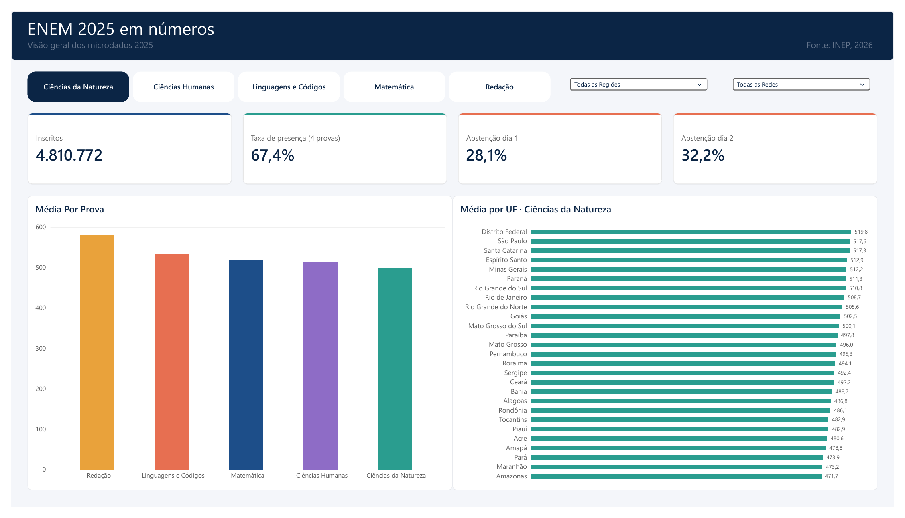
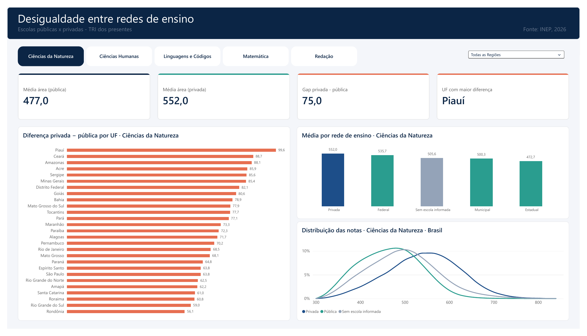
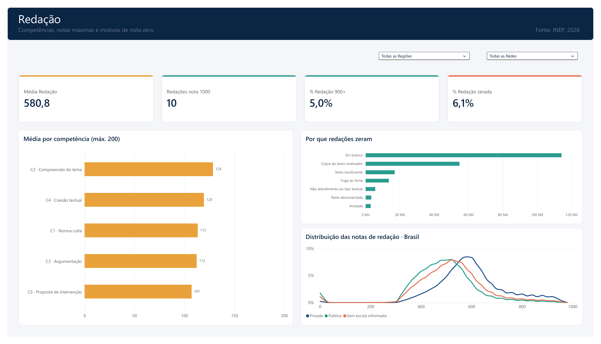
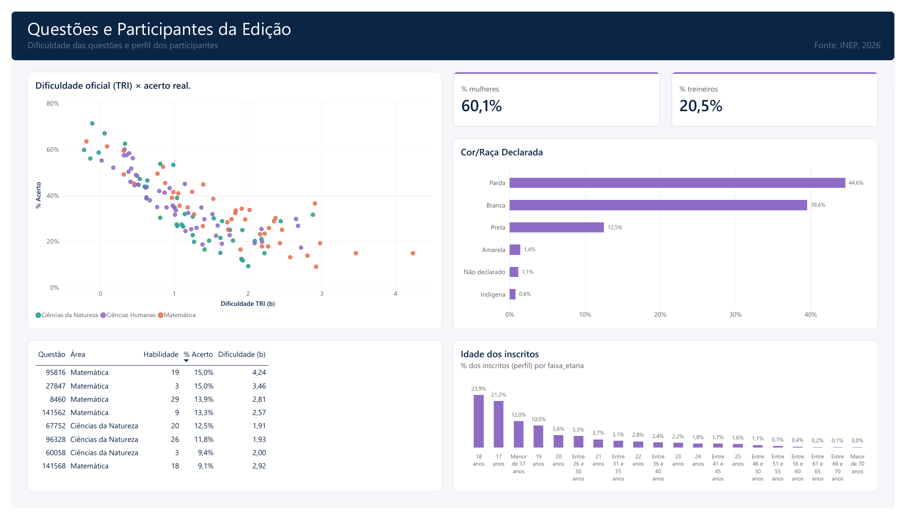

# ENEM 2025 em números · Relatório Power BI

> **Pergunta central:** onde e para quem o ENEM 2025 foi mais difícil, e o que isso diz sobre a desigualdade no ensino médio brasileiro?

Relatório de 5 páginas construído sobre os microdados oficiais do INEP (4,8 milhões de inscritos). Os dados brutos são processados em Python e agregados em tabelas leves, que o Power BI carrega em segundos.

### 📄 [Ver o relatório em PDF](Projeto%20ENEM%202025.pdf) &nbsp;·&nbsp; 📊 [Baixar o modelo Power BI (.pbit)](Projeto%20ENEM%202025.pbit)

---

## Galeria

**1 · Visão geral**


**2 · Desigualdade entre redes de ensino**


**3 · Redação**


**4 · Questões e participantes**


**5 · Conclusões**


---

## Páginas do relatório

| Página | Pergunta | Principais visuais |
|---|---|---|
| **1 · Visão geral** | Quantos fizeram a prova e como foi o desempenho? | Indicadores de participação, média por prova, ranking de UFs |
| **2 · Desigualdade** | Quanto a rede de ensino pesa na nota? | Diferença privada − pública por UF, média por rede, distribuição das notas |
| **3 · Redação** | Onde os participantes perdem pontos e por que redações zeram? | Média por competência, motivos de nota zero, distribuição das notas |
| **4 · Questões e participantes** | A dificuldade oficial bate com o acerto real? Quem fez o ENEM? | Dispersão TRI × acerto, 10 questões mais difíceis, perfil dos inscritos |
| **5 · Conclusões** | O que os dados mostram? | Quatro achados, limitações e metodologia |

---

## Resultados

### Participação
Dos **4.810.772 inscritos**, **67,4%** fizeram as quatro provas objetivas. A abstenção foi de **28,1%** no primeiro dia e de **32,2%** no segundo: parte de quem foi ao primeiro dia não voltou para o segundo.

### Desigualdade entre redes
Em Ciências da Natureza, alunos de escolas **privadas** tiveram média **75 pontos** acima dos de escolas **públicas** (552,0 × 477,0). A diferença varia muito entre estados e chega a **99,6 pontos no Piauí**.

"Escola pública", porém, não é uma categoria homogênea: as escolas **federais** (535,7) ficam próximas das privadas e mais de 60 pontos acima das **estaduais** (472,7), que concentram a maior parte dos alunos. Parte dessa vantagem vem do processo seletivo de muitas escolas federais.

Entre os estados, a média de Matemática vai de **560,5 em São Paulo** a **464,7 no Amazonas**.

### Redação
A redação teve a **maior média do exame (580,8)**, mas apenas **10 notas 1000** e **5%** de notas acima de 900. Por competência, a mais fraca é a **C5 · proposta de intervenção** (107 de 200) e a mais forte, a **C2 · compreensão do tema** (129).

**6,1%** das redações zeraram. Depois da redação em branco, o motivo mais comum é a **cópia do texto motivador** (~55 mil redações), três vezes mais frequente que a fuga ao tema.

### Questões
As questões com menor acerto são todas de **Matemática** e **Ciências da Natureza**, com acerto entre **9% e 15%**: abaixo dos 20% esperados no chute. A dispersão entre dificuldade oficial (parâmetro *b* da TRI) e acerto real mostra forte relação negativa, como esperado.

### Perfil dos inscritos
**60%** dos inscritos são mulheres, e **21%** são treineiros, que fazem a prova antes do último ano do ensino médio.

---

## Como abrir o relatório

O arquivo `.pbit` é um **modelo** do Power BI: contém as páginas, o modelo de dados e as medidas, mas não os dados. Para abri-lo com os dados:

1. Gere as tabelas com o pipeline abaixo (`scripts/02_tabelas_powerbi.py`).
2. Abra `Projeto ENEM 2025.pbit` no Power BI Desktop.
3. Se a pasta do projeto estiver em outro lugar, vá em *Transformar dados*, abra a função `LerCSV` e ajuste o caminho em `Pasta` para a sua pasta `projeto-1-analise-powerbi\dados\`. Depois clique em *Fechar e aplicar*.

Para apenas visualizar o resultado, use o [PDF](Projeto%20ENEM%202025.pdf).

---

## Metodologia

### Pipeline
```bash
python scripts/00_baixar_dados.py        # abre o download do INEP e extrai o zip
python scripts/01_inspecionar.py         # confere colunas e categorias
python scripts/02_tabelas_powerbi.py     # gera os CSVs em projeto-1-analise-powerbi/dados/
```

O script lê os 2,6 GB em blocos de 400 mil linhas e roda em cerca de 1 minuto. Ao final, imprime os totais para conferência com os números oficiais (4.810.772 inscritos, 3.244.348 presentes nas quatro provas, 10 redações nota 1000).

### Tabelas geradas

| Tabela | Grão (uma linha por...) | Uso |
|---|---|---|
| `fato_resultados` | UF × rede × localização | presença, somas de notas e redação |
| `fato_distribuicao` | área × faixa de 20 pontos × rede | distribuição das notas |
| `fato_redacao_status` | UF × rede × situação da redação | motivos de nota zero |
| `fato_itens` | questão × rede | % de acerto, parâmetros TRI, habilidade |
| `fato_perfil` | combinação de características | perfil dos inscritos |
| `dim_*` | rótulo | UF/região, rede, localização, área, status, sexo, cor/raça, faixa etária |

As tabelas guardam **somas e contagens**, não médias prontas. Assim, a média continua correta em qualquer combinação de filtros; uma média de médias daria resultado errado.

### Modelo de dados (esquema em estrela)

```
dim_uf[SG_UF_PROVA]                    1 ── * fato_resultados, fato_redacao_status, fato_perfil
dim_rede[TP_DEPENDENCIA_ADM_ESC]       1 ── * fato_resultados, fato_distribuicao, fato_redacao_status, fato_itens
dim_localizacao[TP_LOCALIZACAO_ESC]    1 ── * fato_resultados
dim_status_redacao[TP_STATUS_REDACAO]  1 ── * fato_redacao_status
dim_area[SG_AREA]                      1 ── * fato_itens[SG_AREA], fato_distribuicao[area]
dim_faixa_etaria / dim_sexo / dim_cor_raca   1 ── * fato_perfil
```

Tabelas auxiliares, sem relacionamentos:
- `dim_area_eixo = ALL ( dim_area )`: eixo do gráfico de médias por prova, que destaca a área selecionada sem ser filtrado por ela;
- `dim_competencia`: as 5 competências da redação.

`dim_area` não se relaciona com `fato_resultados`: ela funciona como seletor da medida *Média da área selecionada*.

### Importação no Power Query
Os CSVs são lidos por uma função `LerCSV`, que define codificação UTF-8, separador decimal no padrão americano e os tipos de cada coluna. Isso evita que o Power BI em português interprete `512.3` como `5123`.

### Medidas
Todas as medidas DAX estão em [`medidas.dax`](medidas.dax), incluindo colunas calculadas e tabelas auxiliares.

### Tema
O arquivo [`tema_enem2025.json`](tema_enem2025.json) define cores, fontes e o estilo dos visuais (*Exibição > Temas > Procurar temas*).

---

## Limitações

- **Perfil × notas:** o INEP separou `PARTICIPANTES_2025.csv` e `RESULTADOS_2025.csv` sem chave em comum (LGPD). O perfil dos inscritos é apresentado de forma descritiva, sem cruzamento com o desempenho.
- **Rede de ensino:** só é conhecida para quem estava no ensino médio; egressos aparecem como "sem escola informada".
- **Causalidade:** diferenças entre redes misturam o efeito da escola com o perfil socioeconômico dos alunos.
- **Distribuição das notas:** a tabela de distribuição é nacional, por isso esses gráficos não respondem ao filtro de região.
- **Questões:** as estatísticas por questão consideram apenas a aplicação principal (itens com mais de 100 mil respostas) e excluem itens anulados.

## Rótulos
Os códigos em `dimensoes/` seguem o dicionário de dados do INEP. O `01_inspecionar.py` lista todos os códigos encontrados na base em `data/processed/schema_2025.md`, o que permite conferir as categorias com o dicionário que vem no zip de 2025.
